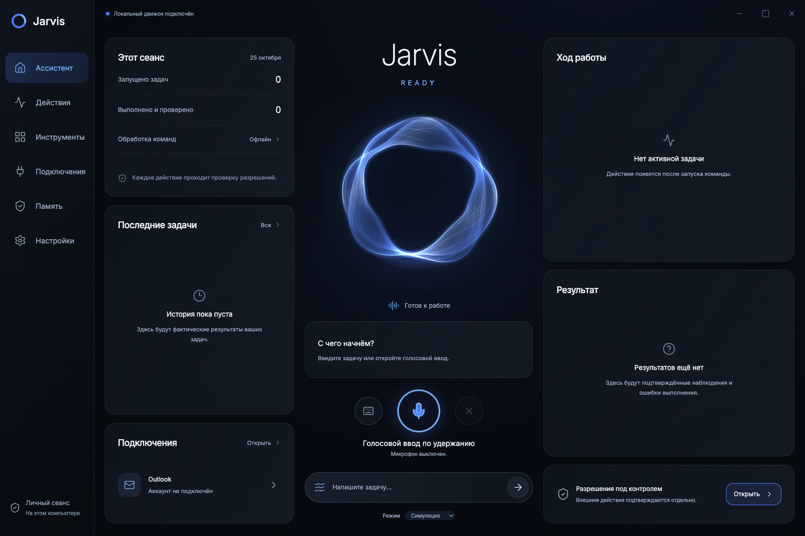

# JARVIS for Windows

Локальный AI-ассистент для Windows 11: текстовые и голосовые команды, строго
типизированные инструменты, подтверждение внешних действий и проверяемый журнал.

**Текущий этап: 9 — подготовка установки и Windows E2E.** Установщик написан;
приёмка на чистой Windows ещё не пройдена. Кнопка «Продолжить» на экране «Ассистент» открывает
многошаговое выполнение с уточнениями, остановкой и подтверждением каждого CONFIRM шага.
По умолчанию включены офлайн-учебные команды и симуляция. Добавлен адаптер OpenAI Responses
API; реальный запрос требует настройки ключа/модели и пока не проверен на живом API.
В окне инструментов доступны восемь
браузерных действий: открытие, переход, поиск, чтение, ввод, клик, список и закрытие вкладок.
По умолчанию Playwright работает в Strict Sandbox — отдельном анонимном сеансе.
Добавлен opt-in **Live Browser** с JavaScript, cookies, HTTPS-редиректами и подключением
к видимому Chrome по CDP. [Настройка режимов и границы защиты](docs/BROWSER_MODES.md).
Навигация, поиск, ввод и обычные клики
выполняются без подтверждения; опасные действия требуют точного approval.
Таблица и ограничения: [политика взаимодействий](docs/PERMISSION_POLICY.md).
В Strict поддерживаются статические страницы без JavaScript и GET-формы;
production POST отключён. В Live сайты выполняют свой JavaScript и сетевые запросы;
JS-кнопки и наблюдённые POST-формы требуют точного approval.
**Native Windows-приёмка ещё не выполнена:** локальные проверки выполняются на macOS.
Кнопка «Запустить демо» по-прежнему запускает демонстрацию. Добавлен локальный голос; настоящий микрофон/распознавание/звук ещё не проверены. Добавлена вкладка Outlook: чтение, локальные/удалённые черновики и отправка с точным подтверждением. Живой OAuth и доставка ещё не проверены.



Новое приложение **Electron + React** открывается в frameless окне1536×1024.
Вместо демонстрационных данных — настоящий Python-движок: команды, остановка,
шаги, результаты и история текущего сеанса. Первый запуск без выдуманных встреч,
профиля и подключений. Из корня: `npm --prefix desktop ci`, затем
`npm --prefix desktop start`. Зависимости Python готовятся автоматически в отдельном окружении.
[Запуск и управление](desktop/README.md) · [Архитектура и проверки](docs/DESKTOP_APPLICATION.md).

Прежний `python -m jarvis` сохранён как совместимая Python-оболочка и текущая цель
Windows-установщика. Защищённые нативные окна подтверждений, модели, голоса, памяти
и Outlook используются новым приложением. Живые подключения и Windows-приёмка
не подтверждены локальными Mac-проверками.

## Установка на Windows по одному запросу

Откройте **полную текущую копию репозитория** в Codex на Windows 11 x64 и напишите:

> Установи Jarvis, выполни доступные проверки и покажи итоговый Jarvis-Report.html для отправки.

Агент запускает из корня репозитория:

```powershell
& '.\scripts\windows\Install-Jarvis.cmd'
```

Сценарий готовит Python, отдельное окружение приложения, Chromium и русскую модель Vosk,
проверяет зависимости и окно, создаёт **Jarvis** в меню «Пуск». Для первой установки нужны
интернет и минимум 3 GB свободного места; Python/pip вручную не требуются. Повторная команда
проверяет и восстанавливает компоненты. Данные и системные credentials хранятся отдельно.
Если системного русского голоса нет, отчёт укажет его установку через настройки Windows.
Микрофон, OAuth/MFA и точные подтверждения остаются явными действиями пользователя.

Установка автоматически проверяет компоненты, локальные разрешения, планировщик,
временную память и аудит. После успеха, ошибки или обычной отмены формируется документ
`%LOCALAPPDATA%\JarvisInstall\Jarvis-Report.html` и его текстовая копия `Jarvis-Report.md`.
Откройте HTML в браузере и отправьте **только этот файл** в чат: он самодостаточный,
на русском, без внешних ресурсов. Можно отправить Markdown вместо HTML.
В документе — что работает по фактической проверке, что требует настройки, что ещё
не проверено, ошибки и следующие шаги. Речь, реальные аккаунты и полный Windows E2E
требуют участия пользователя; обнаружение устройства или библиотеки не означает успех функции.
Исходные `installation-report.md`/`.json` и `installation-bootstrap.md`/`.json` сохраняются;
в итог попадают только результаты одной попытки с одинаковым `run_id`.
При раннем отказе отчёт создаётся во временном каталоге, его путь виден в консоли.
[Проверки, статусы и чтение отчётов](docs/INSTALLATION_DIAGNOSTICS.md).

**Windows-установщик пока не прошёл native-приёмку.**
[Устройство и ограничения](docs/MILESTONE_9.md) ·
[Команды и приёмочная матрица](docs/WINDOWS_ACCEPTANCE.md).
CMD задаёт execution policy только дочернему процессу PowerShell; системные политики
не изменяются, Group Policy/SmartScreen/UAC не обходятся. Ярлык запускается через Python,
без PowerShell и зависимости от расположения репозитория.

## Запуск из исходников для разработчика: Windows 11, PowerShell

Установите Python 3.12 x64 с python.org и Git. Из выбранного каталога:

```powershell
git clone git@github.com:xumezzan/JARVIS-Windows.git
cd JARVIS-Windows
py -3.12 -m venv .venv
.\.venv\Scripts\python.exe -m pip install -e ".[dev]"
.\.venv\Scripts\python.exe -m playwright install chromium
.\.venv\Scripts\python.exe -m jarvis
.\.venv\Scripts\jarvis.exe --version
```

Клонирование требует SSH-доступа к GitHub и наличия опубликованных файлов.
Если вы уже открыли рабочую копию, начните с создания `.venv`.
Активировать окружение и менять PowerShell ExecutionPolicy не требуется.

Откроется окно **Jarvis**. На экране «Ассистент» введите команду и нажмите
«Продолжить» или Ctrl+Enter: откроется окно проверки команды с отдельной кнопкой запуска.
По умолчанию выбраны офлайн-провайдер и симуляция. Запись начинается только по удержанию
кнопки в ассистенте. В разделе «Инструменты» доступны «Браузер и приложения», а также
сворачиваемая демонстрация интерфейса с отдельным вводом и сценарием «Проверить ошибку».
Демонстрация не выполняет команду; Escape и «Остановить демо» отменяют её.

Для автоматической проверки с открытием и закрытием окна:

```powershell
.\.venv\Scripts\python.exe -m jarvis --smoke-test
```

Ожидаемый результат: `Jarvis GUI smoke: success`, exit code 0.

## Проверка разрешений

1. Откройте «Инструменты» → «Браузер и приложения». Simulation Mode включён по умолчанию.
2. SAFE проверяется без диалога; итог симуляции — `SIMULATED`, adapters не вызываются.
3. Выберите CONFIRM, проверьте аккаунт, получателя, тему и содержание.
4. Нажмите «Подготовить и запустить». Диалог показывает точный неизменяемый снимок,
   включая сервис, тип действия, режим и пустой список вложений.
5. Только кнопка «Подтвердить показанное действие» выдаёт одноразовое разрешение.
   Отмена, закрытие, истечение 60 секунд и изменение снимка запрещают выполнение.
6. Если снять Simulation Mode, подтверждённое сообщение добавится только в память
   локального тестового ящика. Счётчик доказывает эффект, внешней отправки нет.
7. CRITICAL и BLOCKED всегда отклоняются. Stop/Escape отменяют незавершённую задачу.

Тестовый ящик очищается при закрытии окна инструментов. Тестовый ящик не использует SMTP/OAuth или сеть. Новое действие с теми же данными требует нового подтверждения.

## Голосовые команды (этап 6)

Установите необязательные голосовые зависимости в окружение проекта:

```powershell
.\.venv\Scripts\python.exe -m pip install -e ".[dev,voice]"
.\.venv\Scripts\python.exe -m jarvis
```

Скачайте и распакуйте русскую модель из [официального списка Vosk](https://alphacephei.com/vosk/models),
например `vosk-model-small-ru-0.22`. В планировщике выберите её папку, содержащую `am/final.mdl`.
Приложение не скачивает модели автоматически. Для озвучивания нужен установленный
русский системный голос; оно включается отдельным флажком.

1. Нажмите микрофон на главном экране — откроется планировщик, запись ещё не ведётся.
2. Удерживайте «Удерживайте для записи команды» мышью или пробелом на кнопке.
   Дождитесь «Идёт запись» и скажите `проверь систему дважды`. Отпустите кнопку.
3. Проверьте и при необходимости исправьте расшифровку в поле команды.
   Нажмите «Запустить планировщик». По умолчанию инструменты симулируются.
4. Во время задачи можно удержать кнопку и сказать `стоп` или `отмена`. Это доступно
   также в окне подтверждения. Голос не подтверждает действия; используйте точную кнопку approval.
5. Stop/Escape/закрытие отменяют работу. Запись ограничена 30 секундами, весь голосовой
   сеанс с проверкой текста — 5 минутами. Во время озвучивания микрофон выключен.

По умолчанию распознавание и озвучивание локальные: аудио не передаётся в облако и не сохраняется.
Если выбран OpenAI-планировщик, проверенный текст отправляется только после его отдельного
разрешения на передачу. Ни API-ключ, ни облачный провайдер для локального голоса не нужны.
См. [результаты и Windows-приёмку этапа 6](docs/MILESTONE_6.md).

### Дополнительный голос ElevenLabs Free

В планировщике доступна кнопка **Настроить голос ElevenLabs Free…**: защищённое
сохранение ключа, список стандартных голосов, проба и согласие на одну облачную озвучку.
Перед синтезом проверяются Free-тариф и остаток лимита; платные аккаунты блокируются.
Нужен личный Free-аккаунт. [Подключение, передача текста и ограничения](docs/ELEVENLABS.md).
Живой API и звучание ещё не проверены.

## Планировщик текстовых команд

1. Нажмите «Планировщик команд». Начните с `проверь систему дважды` и включённой симуляции.
2. Офлайн-провайдер понимает учебные команды: `проверь систему`, `открой блокнот`,
   `открой блокнот и напиши «Привет»`, `открой https://example.com/`, `найди OpenAI`.
   Для произвольных формулировок выберите OpenAI. Офлайн-режим не является LLM.
3. Для реальных инструментов снимите Simulation Mode. Каждый CONFIRM шаг останавливается
   на полном неизменяемом preview; подтвердить весь план заранее нельзя.
4. Вопрос планировщика требует текстового ответа и не выдаёт разрешения на действие.
   Stop/закрытие окна отменяют ожидание. Итог показывает фактические статусы инструментов.
5. Лимиты: 8 действий, 3 уточнения, 30 секунд на ответ провайдера и 180 секунд на задачу,
   включая ожидание подтверждений. Срок отдельного approval — 60 секунд. Повторов после
   ошибки нет; уже выданные действия не откатываются.

В симуляции нет наблюдений окон/страниц: зависимые шаги ввода и чтения не исполняются и
цели не выдумываются. Полная цепочка проверяется только в режиме реального выполнения.

Для OpenAI сохраните ключ **в терминале со скрытым вводом**, не в чате или `.env`:

```powershell
.\.venv\Scripts\python.exe -m jarvis.security.credentials set
.\.venv\Scripts\python.exe -m jarvis
```

На macOS: `.venv/bin/python -m jarvis.security.credentials set`. Используется Windows
Credential Locker / macOS Keychain, сервис `Jarvis/OpenAI`, аккаунт `default`.
Повторный `set` заменяет ключ; удалить его можно через системный менеджер учётных данных.
Linux backend на этом этапе не подключён; офлайн-режим доступен.

В окне выберите OpenAI, укажите доступную вашему API-аккаунту модель Responses API со
strict function calling и разрешите передачу команды, уточнений и результатов инструментов.
API тарифицируется отдельно. Облачный планировщик обращается к модели даже при симуляции
инструментов. `store=false` не гарантирует отсутствие хранения у провайдера.
Доступность модели, ключа и живой API-сценарий нужно проверить отдельно:
[команды и ограничения этапа 5](docs/MILESTONE_5.md).

## Разработка на macOS/Linux

Можно запускать и проверять оболочку; это не доказывает работу на Windows.

```bash
python3.12 -m venv .venv
.venv/bin/python -m pip install -e '.[dev]'
.venv/bin/python -m playwright install chromium
.venv/bin/python -m jarvis
.venv/bin/python -m pytest
.venv/bin/python -m ruff check .
.venv/bin/python -m ruff format --check .
.venv/bin/python -m mypy
.venv/bin/python -m build
```

## Windows-инструменты

1. Откройте «Инструменты» → «Браузер и приложения». Сначала выбран Simulation Mode.
2. Для реального запуска на Windows снимите Simulation Mode, выберите приложение,
   затем «Windows — открыть приложение». Уже открытое приложение используется повторно.
3. Выполните «Windows — список окон», выберите точное окно; «фокус на окно» проверяет фокус.
4. Для ввода выберите точно наблюдённый поддерживаемый редактор. Для непустого редактора
   требуется снимок digest текущего текста; изменение после наблюдения отклоняется.
5. Выберите «текст в выбранный редактор», введите содержание и запустите действие.
   Без диалога подтверждения текст записывается буквально и читается обратно для сравнения.
6. Stop/Escape завершают helper; уже переданное Windows действие может сохраниться.

Открытие и фокус поддерживают Notepad, Chrome и VS Code в стандартных каталогах установки.
Cross-app ввод, ограниченные hotkeys и клики описаны в
[WINDOWS_CROSS_APP.md](docs/WINDOWS_CROSS_APP.md). Shell-команд и произвольных hotkeys нет.
На macOS реальный Windows-запуск возвращает понятный отказ. В симуляции окна не ищутся;
для focus/type нужен ранее наблюдённый target, выдуманные окна UI не создаёт.

## Браузерные инструменты

1. Откройте инструменты. В Simulation Mode браузер не запускается, сеть не используется;
   схемы, разрешённые адреса и политика риска всё равно проверяются.
2. Для реального чтения снимите Simulation Mode, выберите «Браузер — открыть страницу»,
   оставьте `https://example.com/` и запустите действие без approval-диалога.
3. После открытия появятся наблюдённая вкладка, заголовок, текст и доступные элементы.
   Для новой страницы сначала выполните чтение; ввод/клик используют только наблюдённые цели.
4. Поиск DuckDuckGo открывает новую вкладку без approval. Сайт может вернуть challenge
   или отказ; это не доказательство результатов поиска.
5. Ввод буквальный, без Enter/клавиатурных сценариев. Обычные GET-клики выполняются сразу;
   опасные подписи и закрытие изменённой формы требуют подтверждения. Production POST,
   авторизация, загрузки, popup и редиректы запрещены.
6. Stop отменяет ожидание, но не отзывает уже выданный запрос. При сбое новой вкладки
   существующие вкладки сохраняются. Закрытие окна инструментов удаляет весь его временный
   сеанс, включая введённый текст; сохранения/восстановления сеанса пока нет.

Разрешены точные HTTPS origins из `JARVIS_BROWSER_ORIGINS`. По умолчанию: `example.com`,
`www.python.org`, `docs.python.org`, `html.duckduckgo.com`. Добавление origin не разрешает
локальную/приватную сеть, POST или JavaScript. DNS проверяется при реальном запросе;
в симуляции DNS и доступность страниц не проверяются. Клики на результатах поиска другого
origin потребуют явной настройки allowlist. См. [ограничения этапа 4](docs/MILESTONE_4.md).

## Документация

- [PRD](docs/PRD.md): сценарии и границы MVP.
- [Архитектура](docs/ARCHITECTURE.md): модули, контракты и принятые решения.
- [Безопасность](docs/SECURITY.md): модель угроз и обязательные ограничения.
- [Roadmap](docs/ROADMAP.md): этапы и точный следующий prompt.
- [Полная цель продукта](docs/PRD.md), [карта возможностей](docs/CAPABILITY_MAP.md),
  [интеграции](docs/INTEGRATIONS.md) и [открытые решения](docs/OPEN_DECISIONS.md):
  документация расширения; этапы 10–32 ещё не реализованы, ближайшая работа — Windows этап 9.
- [Мастер настройки](docs/ONBOARDING.md), [контракт адаптера](docs/INTEGRATION_CONTRACT.md)
  и [будущая E2E-приёмка](docs/PRODUCT_ACCEPTANCE.md): требования следующих версий.
- [Тестирование](docs/TESTING.md): Windows-команды, приёмка и ограничения проверки.
- [Совместимость](docs/COMPATIBILITY.md): официальные источники и стратегия зависимостей.
- [Результаты этапа 4](docs/MILESTONE_4.md): браузер, проверки, ограничения и следующая задача.
- [Результаты этапа 6](docs/MILESTONE_6.md): локальный голос, команды приёмки и ограничения.
- [Результаты этапа 5](docs/MILESTONE_5.md): планировщик, настройка OpenAI и оставшаяся приёмка.
- [Результаты этапа 3](docs/MILESTONE_3.md): Windows-адаптер, проверки и открытая native-приёмка.
- [Результаты этапа 2](docs/MILESTONE_2.md): разрешения, тесты и ограничения.
- [Результаты этапа 1](docs/MILESTONE_1.md): проверки GUI и ограничения.
- [Результаты этапа 0](docs/MILESTONE_0.md): фактические проверки и остаточные риски.
- [AGENTS.md](AGENTS.md): правила работы в репозитории.

## Настройки и локальный журнал

Настройки читаются из переменных процесса. `.env.example` — справочник,
файлы `.env` автоматически не загружаются. Например, в PowerShell:

```powershell
$env:JARVIS_DEMO_DURATION_MS = "4000"
$env:JARVIS_TASK_TIMEOUT_MS = "10000"
.\.venv\Scripts\python.exe -m jarvis
```

| Переменная | По умолчанию | Допустимые значения |
| --- | --- | --- |
| `JARVIS_DEMO_DURATION_MS` | 2400 | 100–30000 мс |
| `JARVIS_TASK_TIMEOUT_MS` | 10000 | 100–60000 мс |
| `JARVIS_ACTIVITY_LIMIT` | 200 | 10–1000 строк |
| `JARVIS_BROWSER_ORIGINS` | Четыре origin выше | Точные HTTPS origins через запятую; пустое значение запрещает сеть |
| `JARVIS_DATA_DIR` | Каталог данных ОС | Путь к доступному каталогу |
| `JARVIS_PLANNER_MODEL` | Пусто | Несекретный ID модели Responses API; можно ввести в окне |

Журнал: `<data_dir>/logs/shell.jsonl`, ротация 1 MB, два резервных файла.
Каталог по умолчанию: `%LOCALAPPDATA%\Jarvis` на Windows,
`~/Library/Application Support/Jarvis` на macOS, `$XDG_DATA_HOME/Jarvis`
(или `~/.local/share/Jarvis`) на Linux.

Команды и принятый текст остаются в окне и не сохраняются в журнале. Там только время,
session/request UUID, режим demo и служебное событие. Микрофон включается только по удержанию кнопки в планировщике. Запущенные Chrome/VS Code могут выполнять собственные сетевые запросы.
Не вводите секреты. Shell log отделён от `<data_dir>/audit.sqlite3` — журнала инструментов. Audit содержит
время, session/request ID, инструмент, риск, режим, permission decision, статус, длительность,
категорию ошибки и признак возможного эффекта. Аргументы/результаты скрыты целиком, токены
не сохраняются. При недоступном обязательном audit adapter не запускается.

Каждый локальный, Windows и browser tool проходит PermissionEngine. Будущие adapters должны использовать
тот же шлюз. План модели
не является разрешением, а успешный план не является доказательством выполнения.

## Этап 7: память

В планировщике появилась вкладка **Память**: явное сохранение коротких меток профиля,
просмотр/изменение/удаление/очистка, ограниченный контекст текущего сеанса. Отметьте нужные
записи для одной задачи; передача меток в OpenAI требует отдельного согласия. Автоматического
сохранения речи, команд и страниц нет. «Открой выбранное приложение» использует выбранную
метку приложения и заново наблюдает Windows-окно. Контактные ссылки требуют уточнения.

[Описание, ограничения и приёмка Windows](docs/MILESTONE_7.md). Реальные Windows, LLM и голос
остаются непроверенными; внешние сервисы и установка из репозитория — следующие этапы.


## Outlook (этап 8)

**Планировщик → Outlook**: явный вход Microsoft, точный аккаунт, чтение, локальный черновик,
сохранение в Outlook без approval и отправка через отдельное подтверждение. По умолчанию инструменты
работают в simulation. Настройка входа требует вашего Application (client) ID и согласия
в Microsoft; токены хранятся только в OS credential store. `202 Accepted` не доказывает доставку.

[Настройка, ограничения и Windows/почтовая приёмка](docs/MILESTONE_8.md).
Установщик по одному запросу подготовлен на этапе 9; его Windows-приёмка остаётся открытой.

## Прямые файловые инструменты

Добавлены `fs.search`, `fs.read_document`, `fs.write_file` и `python.sandbox_eval`:
работа с документами и CSV/JSON без GUI. Чтение ограничено рабочими папками; создание
без подтверждения — только в `workspace`, перезапись — по прочитанной версии и точному
подтверждению. Вычислитель поддерживает ограниченное подмножество Python.
[Конфигурация, ограничения и проверки](docs/FILESYSTEM_TOOLS.md).
