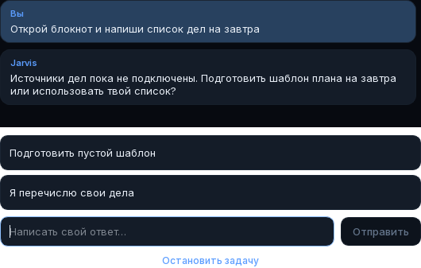

# Уточнения в чате задачи

Вопрос «что записать в список дел на завтра?» больше не открывает отдельное
окно. Главная карточка «Чат с Jarvis» показывает принятую команду, вопрос,
нажатый или написанный ответ и фактический итог. После ответа продолжается
тот же запуск, с его шагами, бюджетом и журналом.

Изображение — offscreen-рендер настоящих Qt-виджетов с синтетическим вопросом,
без вызова модели или чтения подключённых аккаунтов.

Модель предлагает до четырёх коротких вариантов, когда выбор полезен. Всегда
остаётся поле «Написать свой ответ…»: Enter или «Отправить» передают текст.
Ничего не выбирается автоматически. Старый провайдер без вариантов показывает
вопрос и поле ввода. В офлайн-режиме примеры простых команд также доступны
кнопками. В самостоятельном планировщике используется такая же карточка.

«Остановить задачу», Esc, закрытие и таймаут отменяют ожидание. Повторный ответ
или запоздалый клик от предыдущего вопроса не отвечают на новый. Переписка
в карточке ограничена двенадцатью сообщениями и очищается перед новым поручением;
отдельный журнал переписки на диск не записывается. Исходная команда по-прежнему
остаётся в существующем журнале задач для возобновления. В облачном режиме команда
и уточнения передаются провайдеру по сохранённому согласию. В shell-журнал ответы
не добавляются.

Ответ уточняет данные. Он не выдаёт токен разрешения: отдельное подтверждение
действия, его точный снимок, режим автономности и движок разрешений работают
по прежним правилам. Модель и варианты ответа не могут менять эти настройки.
Текст вопросов и кнопок отображается как обычный текст, без загрузки ссылок
или HTML. Появление вопроса не включает микрофон.

Общие инструкции DeepSeek/OpenAI требуют самостоятельно выбирать обычное
оформление и сначала получать доступные сведения через инструменты чтения.
Личные дела и сроки не выдумываются: при отсутствии источников можно предложить
пустой шаблон или попросить список владельца. Это инструкция модели, а не
гарантия отсутствия всех лишних вопросов или подключение сервисов.

Проверки: `tests/integration/test_task_chat.py` — ответы, продолжение, отмена,
таймаут, отсутствие модального окна, граница подтверждений, обычный текст,
перенос длинных вариантов и отображение советов при ошибке;
`tests/unit/test_clarification.py` — границы вариантов и оба протокола моделей.
Голосовая отмена проверяется существующими fixture-тестами. Живой микрофон,
аккаунты и вызовы моделей этими тестами не проверяются.
