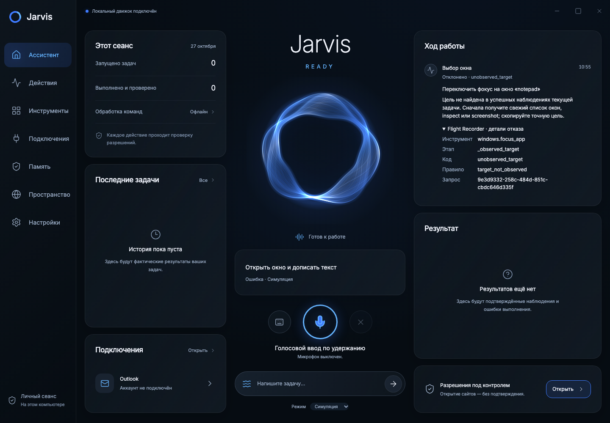

# Диагностика отказов и Self-Healing Runner

Проверка от 27 октября 2026 года, исходная точка: `main` `f329f02`.
Разработка и локальные проверки выполнены на macOS. Доступа к пользовательскому
Windows 11, его `%LOCALAPPDATA%`, установленному слоту и окну приложения нет.
Статистика его отказов, обновление слота и перезапуск **не выполнены**.

## Получение фактической статистики

`scripts/windows/diagnose_failures.py` использует только stdlib. Он проверяет
`JARVIS_DATA_DIR`, `%LOCALAPPDATA%\Jarvis` и каждый существующий
`%LOCALAPPDATA%\Packages\*\LocalCache\Local\Jarvis`, включая случай уже
виртуализированного `LOCALAPPDATA`. `--data-dir` добавляет явно указанный каталог.
Каждая БД открывается через SQLite `mode=ro` и `query_only`; скрипт не вызывает
MemoryStore и не удаляет истёкшие задачи. Он читает последние 50 **записей**, включая
жизненный цикл prepared/started/finished, из каждого audit отдельно. Таблица отказов
выделяет ERROR, DENIED, CANCELLED, TIMEOUT и INVALID. Счётчики считаются по этой
выборке, а не по всем задачам или всем событиям за день.

После установки скрипт также лежит рядом со стабильным launcher в JarvisInstall:

```powershell
$jarvisRoot = Join-Path $env:LOCALAPPDATA 'JarvisInstall'
$report = Join-Path $env:TEMP ('Jarvis-flight-recorder-' + (Get-Date -Format 'yyyyMMdd-HHmmss'))
& (Join-Path $jarvisRoot 'runtime\python.exe') -I `
  (Join-Path $jarvisRoot 'diagnose_failures.py') --output $report
```

Для старой установки до появления этой копии используйте скрипт из репозитория
с тем же установленным Python; ручная установка Python/pip не нужна:

```powershell
& (Join-Path $jarvisRoot 'runtime\python.exe') -I `
  '.\scripts\windows\diagnose_failures.py' --output $report
```

Отчёт создаётся в новом каталоге: `failures.md` и `failures.json`. Указывается
состояние каждого источника, число записей, счётчики статусов/кодов/этапов и таблица
с request ID. `shell.jsonl` содержит события оболочки, а не полные tool outcomes;
Electron не ведёт этот Qt-журнал. `recent_tasks` сохраняет только полностью успешные
задачи, поэтому отсутствие там неуспешной задачи не доказывает отсутствие отказов.
Скрипт выводит из памяти только ID, время и маршрут инструментов; команды, содержимое
полей, скриншоты и аргументы в отчёт не копируются.

Старые записи не содержат stage/reason. Скрипт пишет «не записан», не угадывая этап
по одному error code. Восстановить исходные `[REDACTED]` аргументы из audit невозможно.
Запуск скрипта на текущем Mac сообщил `Host: Darwin`, отсутствие LOCALAPPDATA и
недоступность Windows data roots. Это не нулевая статистика отказов Windows.

## Активные ограничения и изменения

| Компонент / проверка | До изменения | Теперь |
|---|---|---|
| `windows.open_app`, `NativeDesktop.catalog/resolve_app` | Любое установленное приложение из AppsFolder, Start menu, App Paths и системного каталога; это уже не allowlist из трёх приложений | Тот же каталог; `.exe` правильно нормализуется; добавлен `cmd.exe` без аргументов по решению владельца |
| Каталог запуска | AppsFolder до 1000, Start menu до 2000 ссылок на каталог, App Paths до 500 ключей на hive | Сохранено; неоднозначное имя требует уточнения; пути, командные строки и аргументы не принимаются |
| Остальные интерпретаторы/системные хосты | `SCRIPT_HOSTS`: PowerShell/pwsh, Python/pythonw, cscript/wscript, mshta, regedit/regsvr32/rundll32, Terminal/wt и варианты названий | Сохранено; только cmd/Command Prompt/Командная строка исключены из запрета |
| Workspace native apps | `native_exe_hint` не использовался при запуске по имени профиля | Включённое native/hybrid приложение по ID/имени разрешается через его локальную подсказку и тот же Windows-каталог; hint не отправляется модели |
| `DesktopService.start` → `chrome_destination` | `открой calc.exe` считалось веб-командой из-за точки и шло в Chrome | `.exe` без явного указания сайта/браузера/перехода остаётся запросом приложения |
| `get_open_windows` | Только точное совпадение process key | Частичное совпадение имени процесса или заголовка, `.exe` поддерживается |
| `focus_app` | target, handle или часть заголовка | Добавлен process selector. Runner привязывает уникальное совпадение из текущих наблюдений к точному WindowTarget до prepare |
| `NativeDesktop.resolve` | В части операций требовался неизменный заголовок | Заголовок по умолчанию не участвует в идентичности; app, handle, PID, process start time, executable и runtime ID по-прежнему проверяются |
| Окна оболочки | Не показываются окна без заголовка и классы Progman, WorkerW, Shell_TrayWnd, Shell_SecondaryTrayWnd, tooltips_class32; максимум 100 окон | Сохранено. ApplicationFrameHost, Electron и браузеры по классу не запрещены |
| `only_empty_notepad` | Символа/проверки с таким именем нет. Но `resolve_editor` отказывал заполненным полям без overwrite, а offline-рецепт требовал empty | Пустота не требуется в обоих местах; обычный ввод дописывает в конец, overwrite=true заменяет текст |
| Поля ввода | Только наблюдавшийся Edit/Document; writable ValuePattern; пароли/read-only отбрасываются; неоднозначные поля не выбираются | Сохранено. До 20 полей из первых 40 найденных; проверяются роль, class, automation ID, имя, выбранные вкладки и digest содержимого |
| Механизм ввода | Направленные WM-сообщения или UIA ValuePattern; отдельные clipboard_get/set и фиксированные hotkeys | Сохранено. Дописывание проверяется по digest полного результата, вставка Ctrl+V привязана к наблюдавшемуся SHA-256 буфера и foreground окна |
| UIA traversal | BFS до 16 уровней, 2048 узлов, 96 интерактивных элементов | Глубина 32; прочие бюджеты сохранены. Достижение глубины/числа узлов отмечается truncated |
| UIA metadata | Роли Button/Edit/Document/TabItem/ListItem; видимые, enabled, не password; имя до 120 символов; 67 000 байт metadata | Сохранено; длинные имена связаны SHA-256 и не дают автоматического чувствительного клика |
| Скриншоты | JPEG до 1280×800 и 48 KiB; только последний успешный кадр следующему запросу; без bytes в audit/history | Сохранено |
| `ProcessBackend` | Новый killable helper на вызов, 8 секунд по умолчанию; конструктор допускает до 10; tool timeout 30 секунд; запуск ожидает окно до 6 секунд | Сохранено. Mac fixtures не доказывают, что эти сроки достаточны на реальном ноутбуке |
| Runner limits | 30 действий, 32 model calls, 3 уточнения, 30 секунд/provider, 300 секунд/task | Сохранено: 30 уже превышает запрошенные 25. Неуспешные шаги тоже расходуют лимит; durable run допускает 64/3600 с журналом |
| Ошибка одного инструмента | Немедленный PlanResult(error); некоторые отказы grounding вообще не имели Step/event | Исправимые ошибки становятся Step + Outcome + notify(tool), поступают следующему запросу модели; после 3 подряд ошибок остановка |

`APP_NAMES` и `LaunchAppId` с notepad/chrome/vscode не определяют нынешний каталог
`open_app`: параметры запуска используют строковый `AppId`, а исполнение — `catalog()`.
Это видно по действующему пути вызова, а не по наличию исторических имён в файле.

## Что именно отказывает в `_observed_target`

По коду известны условия, но без Windows audit невозможно ранжировать их по частоте:

- Windows click: нет последнего успешного inspect/screenshot этого exact target;
  после open/focus/click/type/hotkey старые marks недействительны; полный элемент или
  rectangle должны совпадать. Несуществующий mark_id получает `stale_mark`.
- Остальные Windows targets должны присутствовать в успешном наблюдении этой задачи;
  editor — в том же наблюдении окна; calculator — совпасть с наблюдённым состоянием;
  Ctrl+V — совпасть с последним наблюдавшимся digest буфера.
- Browser click/type требуют элемент из последней страницы конкретной вкладки;
  изменённый документ, закрытие, affected_tab и мутации инвалидируют старый target.
- Versioned fs overwrite требует успешный `fs.read_document` с тем же path/version
  и `truncated=false`.
- Outlook/Calendar требуют наблюдавшийся аккаунт. Read сообщения требует ранее
  перечисленный ID; изменения встречи — наблюдённый ID; create_event — точный local draft.
  Адресаты должны явно присутствовать в команде/ответе владельца, иначе уточнение.

Проверки продолжают исполняться перед действием. Отказ теперь записывается как
`DENIED/unobserved_target`, этап `_observed_target`, а не как отмена без карточки.

## Браузер и ярлык

`AppConfig` и пустой `WorkspaceProfile` по умолчанию используют Strict Sandbox.
`load_config` выбирает режим в порядке: `JARVIS_BROWSER_MODE`, затем сохранённый
`ui_settings.browser_mode`, затем `workspace_profile.browser_mode`, затем Strict.
`Launch-Jarvis.pyw` не назначает режим браузера; он восстанавливает data directory,
поэтому у существующей установки режим может отличаться от нового default.

Strict: JS выключен, anonymous offline context, одна точная document grant через
проверенный транспорт; exact origins, DNS/public-address проверки, запрет реального
POST кроме injected local fixture, popups/downloads/service workers запрещены.
Transport не использует cookies/auth/proxy/redirect/retry; сетевой timeout 8 секунд.

Authenticated Workspace: JS включён, отдельный persistent profile или явно настроенный
CDP, вход выполняет владелец. Ограничения сайтов/методов, private-network grants,
password/OTP filtering, exact tab/document/DOM/element/form binding сохраняются.
UIA/DOM наблюдение само по себе не подтверждает действие. Таймаут BrowserHost —
30 секунд для Workspace и 15 для остальных режимов; DOM — 5 секунд, navigation — 10.
До 32 вкладок Workspace, 8 в остальных режимах.

Отдельный `windows.open_chrome_url` открывает обычный Chrome текущего профиля и
не использует Strict Sandbox. Его receipt доказывает только передачу адреса Chrome,
не загрузку сайта. Веб-команды в Electron могут идти по этому маршруту без модели.
Офлайн-провайдер по умолчанию понимает конечные рецепты; сложная формулировка вне
них вызывает уточнение. Self-healing не превращает OfflineProvider в LLM.

## Семантика восстановления и Flight Recorder

`Outcome` и audit теперь несут конечные `stage` и `reason`. Ошибки остаются кодами,
а человекочитаемая причина строится только из доверенного словаря в
`observability/diagnostics.py`; исходный native exception text не записывается.
Сохраняется зарегистрированное имя инструмента даже при неправильных аргументах.
В audit по-прежнему нет тела письма, текста поля, UIA-дерева или скриншота.

В следующий OpenAI request и общий provider context поступают status/error/failure:
этап, правило, сообщение и may_have_effects. Восстановимы invalid_request,
unobserved_target, precondition_failed, target_changed/page_changed,
control_unsupported, application_missing/ambiguous и verification_failed.
Отмены, timeouts, policy/approval/audit/journal failures не обходятся.

Это перепланирование, а не повтор adapter call внутри PermissionEngine. Одно действие
по-прежнему исполняется один раз. Точный ключ непроверенного эффекта запрещает повтор,
в durable run работает прежний журнал. После verification failure можно наблюдать
состояние, но финальный отчёт оставляет эффект неподтверждённым; слова модели
«готово» не меняют его статус. Эффекты Windows/браузера учитываются и при SAFE risk.

Electron показывает в каждой неуспешной карточке намерение и причину, а в раскрываемом
Flight Recorder — tool, stage, error, reason, request ID. Причина видна до раскрытия.
Текст поля не включается в локальную подпись намерения.



## Проверки и Windows-приёмка

Воспроизводимые локальные команды:

```sh
.venv/bin/python -m pip install -e '.[dev]'
QT_QPA_PLATFORM=offscreen .venv/bin/python -m pytest
.venv/bin/python -m ruff check .
.venv/bin/python -m ruff format --check .
.venv/bin/python -m mypy
.venv/bin/python -m pip check
QT_QPA_PLATFORM=offscreen .venv/bin/python -m jarvis --smoke-test
.venv/bin/python -m build
npm --prefix desktop run build
JARVIS_PYTHON="$PWD/.venv/bin/python" node desktop/scripts/verify-flight-recorder.cjs /tmp/jarvis-flight-recorder-qa
```

Renderer QA использует реальную Python-проекцию синтетических событий, размеры
1440×1000 и 1024×768; это не проверка нативного Electron/Windows UIA.

Фактические локальные результаты: **1935 passed, 23 skipped**; Ruff check/format,
mypy (351 файлов), pip check, GUI smoke и wheel/sdist build прошли. Electron tsc/Vite
build с синхронизацией prebuilt assets прошёл; 17 Electron unit tests и renderer QA
Flight Recorder прошли. Первая полная проверка выявила 12 регрессий: совместимость
статусов нормализации, бюджет metadata и ожидания старых тестов без карточек отказа;
они исправлены, полный повтор прошёл. Нативные Windows/model/voice opt-in и 17
сценариев PowerShell на Mac пропущены. CI и приёмка ноутбука — отдельные проверки.

После включения изменения в опубликованный main на ноутбуке владельца:

1. Запустить диагностику до обновления и сохранить отчёт.
2. Выполнить `scripts\windows\Update-Jarvis.cmd`, проверить выбранный commit и
   связанные update/installation/bootstrap отчёты. `Install-Jarvis.cmd` подходит
   для явного локального repair выбранной версии и не считается обновлением исходников.
3. Проверить реальное окно и ярлык; сохранить файлы/настройки/credentials.
4. Проверить отдельно `открой calc.exe`, `explorer.exe`, `mspaint.exe`, `cmd.exe`,
   приложение из Start menu и native Workspace app. Для cmd проверяется только
   открытие окна, команды не отправляются.
5. В обычном непарольном поле проверить append/overwrite, Ctrl+V с digest,
   динамический заголовок окна и глубокий UIA. Проверить видимый отказ при stale
   элементе, fresh inspect и следующий шаг; отмена/неподтверждённая отправка обязаны
   остановить выполнение. Старый или чужой target не должен получать ввод.

Hosted Windows CI проверяет переносимые контракты и сборку, но не заменяет эти
проверки на пользовательском ноутбуке, живые аккаунты и его установленный слот.
